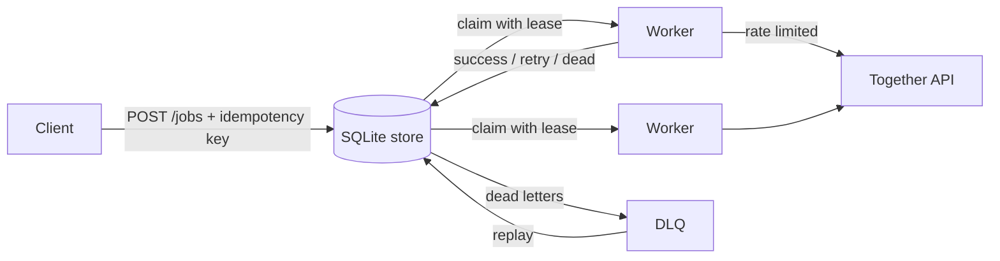

# Rewind

A durable job runner for LLM inference. You hand it thousands of prompts, it gets every one of them through a flaky inference API, and nothing gets lost or run twice by accident.

I built event replay for Azure Event Grid during my internship at Microsoft. Rewind applies the same reliability ideas to LLM inference on [Together AI](https://together.ai): leased work, retries with backoff, a dead-letter queue, and replay.

## What it handles

| Failure | What Rewind does |
|---|---|
| Rate limits (429), server errors (5xx), timeouts | Retries with exponential backoff and full jitter, respecting `Retry-After` |
| Bad requests (400) | Fails fast to the dead-letter queue instead of burning money on retries |
| A client submits the same job twice | Idempotency keys return the original job |
| A worker crashes mid-request | Its lease expires and another worker picks the job up |
| The crashed worker comes back and reports late | Its write is rejected (fencing on lease owner) |
| Jobs that exhaust their retries | Parked in a dead-letter queue, replayable once the API recovers |
| Too many requests at once | Optional token-bucket rate limit across all workers |

## Results

`scripts/chaos_demo.py` runs 500 jobs against a simulated API that rate-limits 15% of calls, errors on 8%, times out on 5%, and rejects 2% as bad requests. It also kills a worker holding 5 jobs and sends 10% of jobs twice.

```
Pass 1: 500 jobs against a flaky API (1.1s, 696 API calls)
  done 477  failed 23  success rate 95.4%
  retries 196  duplicates blocked 50  crashed-worker recoveries 5  stale writes blocked 0

Pass 2: replayed 23 dead-lettered jobs after the API recovered
  done 500  failed 0  success rate 100.0%
  stale writes blocked 477

500 unique jobs, 0 lost, 0 duplicates processed.
```

## Run it

```bash
pip install -r requirements.txt
pytest                                  # 8 tests: retries, DLQ, replay, crash recovery, fencing
python scripts/chaos_demo.py --jobs 500 # the chaos run above

# Service + dashboard with the simulated API
uvicorn rewind.api:app
# open http://localhost:8000

# Against the real Together API
PROVIDER=together TOGETHER_API_KEY=... RATE_PER_SEC=5 uvicorn rewind.api:app
```

Submit work:

```bash
curl -X POST localhost:8000/jobs -H 'content-type: application/json' \
  -d '{"prompt": "Summarize the Raft paper in 3 bullets", "idempotency_key": "raft-1"}'
```

## API

| Endpoint | Purpose |
|---|---|
| `POST /jobs` | Submit one job (`prompt` or `messages`, optional `idempotency_key`, `max_attempts`) |
| `POST /jobs/batch` | Submit many |
| `GET /jobs/{id}` | Job state plus its full event history |
| `GET /jobs?status=dead` | List jobs by state |
| `POST /dlq/replay` | Replay all dead-lettered jobs, or specific `job_ids` |
| `GET /metrics` | Success rate, retries, recoveries, p50/p95 latency, tokens, cost |

## Design



- **SQLite in WAL mode** as the queue. Every state change is one transaction, so a crash at any point leaves the queue consistent. `BEGIN IMMEDIATE` means two processes sharing the file can never claim the same job.
- **Leases, not locks.** A worker owns a job only until its lease expires. The provider timeout is set below the lease length so a healthy worker always finishes before anyone else can reclaim its job.
- **Fencing.** Success and failure writes only apply if the writer still holds the lease. A slow or resurrected worker can't overwrite newer results.
- **At-least-once to the provider, exactly-once job records.** If a request succeeds but the response is lost (network drop), Rewind will retry it, so the provider may see that prompt twice. Job submission itself is deduplicated by idempotency key.

## Limitations and next steps

- Single SQLite file, so throughput is bounded by one machine's disk. Next step would be Postgres with `SELECT ... FOR UPDATE SKIP LOCKED`, or a log like Kafka.
- No lease heartbeats yet, so very long generations need a longer lease.
- Streaming responses aren't supported.
- Cost tracking needs a `pricing.json` with current per-model prices (see `pricing.example.json`).
